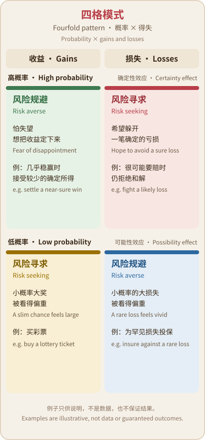

## Four cells, not a rule

Chapter 29 of *Thinking, Fast and Slow* describes a **fourfold pattern** of risk attitudes. Cross high versus low probability with gains versus losses, and the typical choice is not the same in each cell. This is a tendency in how people weigh described prospects. It is not a law everyone follows, and it is not a verdict that lotteries or insurance are always irrational.

<figure class="fourfold-figure">
  
  <figcaption>Axes: probability (high / low) by outcome (gain / loss). The examples only show the cell; they are not data and do not predict a particular choice.</figcaption>
</figure>

## Weights are not probabilities

People do not treat every equal step in probability as equally important. A move from impossible to slightly possible, and a move from almost sure to completely sure, loom larger than the same step in the middle of the scale. Prospect theory calls the numbers people actually use **decision weights**. They track objective probability, but they are not the same thing. Low probabilities tend to be overweighted: the possibility effect. High probabilities tend to be underweighted relative to certainty: the certainty effect.

Kahneman illustrates the cells with prospects that are nearly sure, on the order of 95 percent, and prospects that are unlikely, on the order of 5 percent. Those figures are a teaching contrast, not a measured frequency.

## How the cells line up

When a gain is very likely, the missing sliver of certainty feels large. People often prefer a smaller sure gain to a chance of getting nothing. That is risk aversion, fed by the fear of disappointment.

When a loss is very likely, a sure loss is painful, and a thin hope of escaping it can dominate. People may reject a settlement that would cap the damage and take the gamble instead. That is risk seeking.

When a gain is unlikely, the small chance of a large prize is overweighted. Lottery tickets live in this cell. When a loss is unlikely but serious, that small chance is also overweighted. Paying to remove it is the insurance cell, and it is risk aversion.

Wealth, what a loss would do to someone’s life, and whether a policy actually pools risk all change whether a choice is a good one. A person who buys insurance can be responding sensibly to a loss they cannot absorb. A lottery ticket is not automatically a mistake just because it sits in the risk-seeking cell. The diagram shows how decision weights pull away from stated probabilities. It does not replace those constraints.

Sources: Daniel Kahneman, *Thinking, Fast and Slow* (2011), chapter 29, [Penguin](https://www.penguin.co.uk/books/56314/thinking-fast-and-slow-by-kahneman-daniel/9780141033570). The experimental pattern is set out in Amos Tversky and Daniel Kahneman, “Advances in Prospect Theory,” *Journal of Risk and Uncertainty* 5 (1992), [doi:10.1007/bf00122574](https://doi.org/10.1007/bf00122574).

## 四个格子，不是一条定律

《思考，快与慢》第29章讲的**四格模式**，是人们面对风险时的一种常见倾向。把概率分成高和低，把结果分成收益和损失，四个格子里的典型选择并不一样。这是给“被说清楚的赌局”加权时容易出现的倾向，不是每个人都必须遵守的公式，也不等于买彩票或买保险一定不理性。

<figure class="fourfold-figure">
  
  <figcaption>纵轴是概率的高与低，横轴是收益与损失。格子里的例子只为看清位置，不是调查数据，也不预言某一次选择的结果。</figcaption>
</figure>

## 决策权重不是客观概率

人并不把概率上同样大小的一步看得一样重。从“不可能”跨到“有一点可能”，以及从“几乎确定”跨到“完全确定”，心理上往往重于刻度中间的同样一步。前景理论把人实际使用的这些分量叫做**决策权重**。它们跟着客观概率走，但并不等于客观概率。低概率容易被高估，这是可能性效应；高概率相对“确定”又容易被低估，这是确定性效应。

卡尼曼用接近确定的前景（大约九成五）和可能性很小的前景（大约百分之五）来对照四个格子。这些数字是讲解用的对照，不是测得的发生频率。

## 四个格子怎样对上

收益已经很有希望到手时，缺掉的那一点确定性会显得很大。人们常常宁可接受少一点、但是确定的收益，也不愿冒一场落空。这是风险规避，背后是怕失望。

损失已经很有可能发生时，一笔确定的亏损让人难受，躲开它的一线希望会显得很亮。人们可能拒绝一个能把损失封住的方案，反而去赌。这是风险寻求。

收益的机会很小时，中一个大奖的微弱可能被看得偏重。彩票落在这一格。损失的机会很小、但后果严重时，这个微弱可能同样被看得偏重。花钱把它买掉，就是保险这一格，态度是风险规避。

钱是否够用、这笔损失会不会伤到生计、保单有没有真的把风险分摊出去，都会改变选择算不算划算。买保险的人，可能只是在避开自己承受不起的损失。彩票落在“风险寻求”一格，也不自动等于买错了。这张图说明决策权重怎样偏离写明的概率，不能代替这些约束。

出处：丹尼尔·卡尼曼，《思考，快与慢》（2011），第29章，[Penguin 书页](https://www.penguin.co.uk/books/56314/thinking-fast-and-slow-by-kahneman-daniel/9780141033570)。实验上的四格模式见 Amos Tversky 与 Daniel Kahneman，〈Advances in Prospect Theory〉，《Journal of Risk and Uncertainty》第5卷（1992），[doi:10.1007/bf00122574](https://doi.org/10.1007/bf00122574)。

